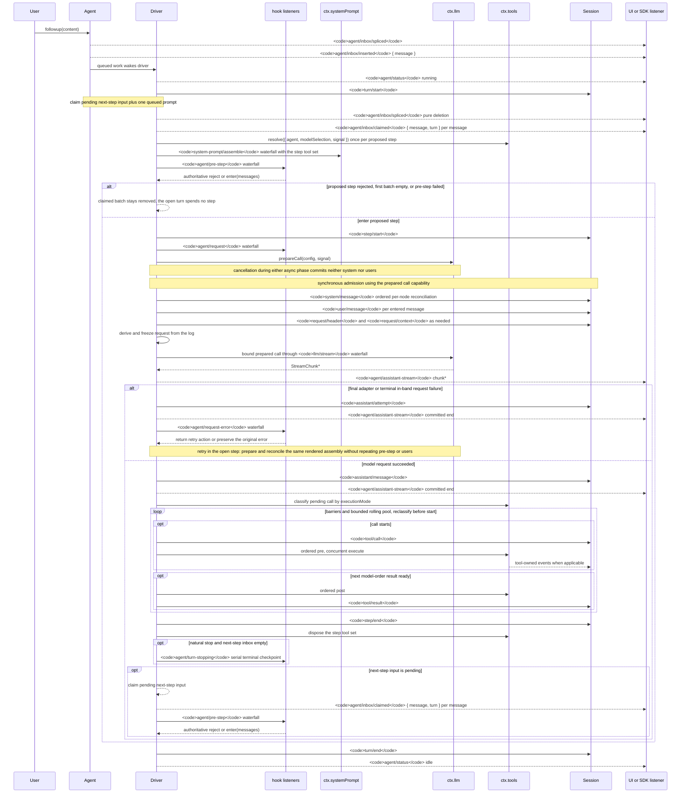

<!-- Generated by scripts/gen-doc-graphs.ts - do not edit by hand.
     Run `pnpm run gen-doc-graphs` to regenerate. -->

# 에이전트 턴과 단계 수명 주기

[English](agent-lifecycle.md) | [中文](agent-lifecycle.zh.md) | 한국어

이 시퀀스는 [architecture.md](architecture.ko.md#턴-흐름)의 시각적 보조 자료입니다. 재생 가능한 영속 사실은 `session/event`에, 실시간 제어·상태는 `agent/*`에 둡니다.

`assistant/message` 이벤트는 콘텐츠가 없는 경우와 `max-tokens`로 도달한 종료를 포함해 성공한 모든 제공자 호출을 기록하며, 실행 시점의 압축된 시간 동기화 스트림 데이터를 그대로 포함합니다. 빈 콘텐츠는 파생된 대화 히스토리에 포함되지 않습니다. 표면 메시지 없이 종료/실패로 확정(settlement)된 실패, 재시도, 취소, 스트림 오류 시도는 해당 스트림을 `assistant/attempt`로 기록합니다. 실시간 `agent/assistant-stream` 청크 프레임은 일시적인 데이터이며, 세션 재생 시에는 영속화된 확정 기록을 읽습니다. 확정 전에 프로세스가 강제 종료되면 영속적인 시도 스트림이 남지 않습니다.

`dsh-compaction-basic`은 요청 생성 전의 컨텍스트 용량 압박 상황에 `agent/pre-step`을 사용하고, 정규 컨텍스트 오버플로 시에만 `agent/request-error`를 사용합니다. 어느 트리거든 조건을 충족하면 선택적인 도구 실행 결과 정리(pruning)가 대화 요약보다 먼저 실행됩니다. 복구 작업은 현재 열려 있는 단계 안에서 실행되며, 정리나 요약 작업이 표면 교체 세대를 진전시킬 때에만 재시도를 수행합니다. 그렇지 않으면 원래 발생한 요청 오류가 최종 유효값(authoritative)으로 유지됩니다. 각 재시도는 요청 생성 전에 호출을 새로 준비하고 보존된 렌더링 조립 상태를 재조정하며, 프롬프트 조립, pre-step, 사용자 메시지 수락을 불필요하게 반복하지 않습니다.

반환된 `agent/pre-step` 결정이 최종 유효값(authoritative)입니다. `next()`를 래핑하는 리스너는 의도적으로 교체하는 경우가 아니라면 다운스트림 메시지와 `startsRequestSeries` 플래그를 그대로 보존해야 합니다. 스티어링(steering) 및 주입된 컨텍스트 역시, 이후 다음 단계 입력을 가져오는(claim) 과정에서 동일한 waterfall 파이프라인을 통과합니다.

재생 가능한 트랜스크립트 데이터가 필요한 SDK 사용자는 `session/event`를 구독해야 합니다. `agent/*`는 작업 큐 및 상태 관리, 프롬프트 가로채기, 요청 구성, 스티어링, 연속 실행, 오류 처리를 위한 실시간 조율(coordination) API입니다.

유지 관리 방식: 선별된 Mermaid 시퀀스이며, 정확한 이벤트 시그니처는 생성된 Cordis 카탈로그에 있습니다.
