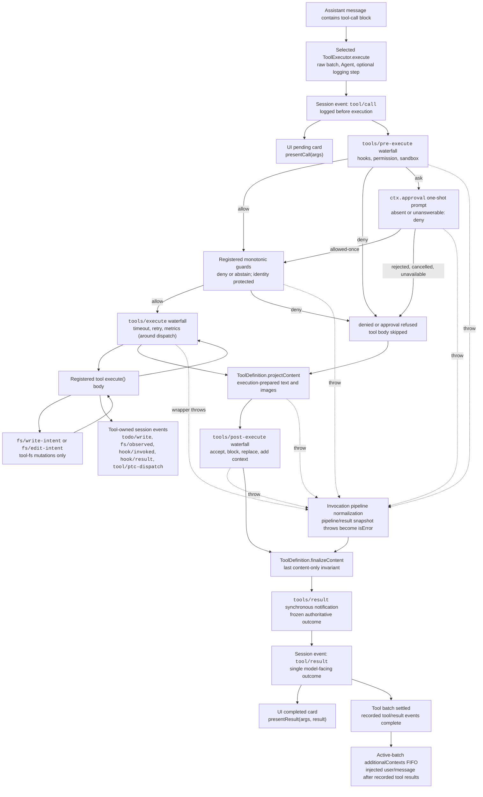

<!-- Generated by scripts/gen-doc-graphs.ts - do not edit by hand.
     Run `pnpm run gen-doc-graphs` to regenerate. -->

# 도구 실행 파이프라인

[English](tool-execution-pipeline.md) | [中文](tool-execution-pipeline.zh.md) | 한국어

내장 실행기는 원시 배치 파싱, 스케줄링, 취소, 세션 호출/결과 로깅을 담당합니다. 이 그래프는 공유 호출 파이프라인이 루프를 바꾸지 않고 정책, 훅, 샌드박싱, 파일시스템 가드, 결과 재작성, 최종 결과 관찰, UI 렌더링을 어디에서 적용하는지 보여 줍니다. `tools/pre-execute` 워터폴이 먼저 실행되고, 단조 가드가 이어지며, `tools/execute`와 `tools/post-execute` 워터폴이 뒤따릅니다. 세 워터폴은 호출을 변환할 수 있습니다. 정의가 소유한 `projectContent`는 post-execute 이전에 준비된 콘텐츠를 설치하고, 그 뒤에 `finalizeContent`와 `tools/result`가 실행됩니다.

파일시스템의 편집 전 읽기 검사는 `fs/*` 이벤트에서 `tool-fs` 아래에 머뭅니다. 일반 pre/post 워터폴은 훅과 승인 정책을 담당합니다. `ctx.approval`은 단조 가드보다 먼저 질의를 해결하며, 재정렬되면 안 되는 소유자 정책은 등록된 가드로 남습니다. 타임아웃처럼 디스패치를 감싸는 관심사는 `tools/execute`를 감쌉니다. 파이프라인은 후보 결과를 무손실로 스냅샷하고, 스냅샷 실패를 정규화한 뒤, 가시적인 정의의 스냅샷된 `finalizeContent` 콜백이 동기적 콘텐츠 전용 불변식을 강제합니다. 그다음 `tools/result`가 변경 불가능한 무손실 JSON 결과를 관찰합니다. 덕분에 훅이 도구를 하나의 정책 서비스에 결합하지 않고 여러 도구 계열에 걸칠 수 있습니다. PTC 모드는 예약된 `run_code` 전송과 그 순서 있는 하위 호출을 모두 파이프라인으로 보냅니다. 하위 호출은 부모 토큰을 지니고, `tool/ptc-dispatch`를 로그하며, 거부를 바인딩 거부로 반환하고, 호출/결과 인접성을 유지하기 위해 `additionalContexts`를 생략합니다.

유지 관리 방식: 선별된 Mermaid 흐름이며, 정확한 도구 스키마와 이벤트 시그니처는 생성된 카탈로그에 있습니다.
