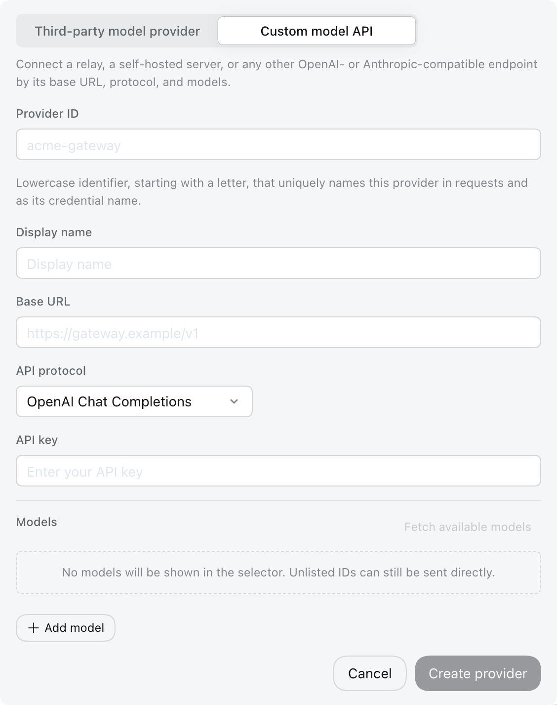

# 모델 구성

[English](providers.md) | [中文](providers.zh.md) | 한국어

이 가이드는 [루트 README](../../../README.ko.md#실행)를 통해 웹 UI를 시작했다고 가정합니다. 모델 변경은 서버를 다시 시작하지 않아도 다음 요청부터 적용됩니다.

## DeepSeek 구성

**설정 → 모델**을 엽니다. DeepSeek 카드는 API 키 필드 하나를 제공합니다. 키를 입력하고 저장하세요.


키는 쓰기 전용(write-only)입니다. 저장 후 화면에는 민감 정보가 마스킹된 설명자만 표시되며 실제 시크릿 키는 노출되지 않습니다. 입력한 키는 `$DSH_HOME/.credentials.yaml`에 저장되고, 설정에는 자격 증명 참조 ID만 유지됩니다.

키를 저장하고 기본 엔드포인트를 사용하면 DeepSeek 모델 목록은 DeepSeek API가 발행하는 공식 목록을 따릅니다. 목록은 모델이 처음 필요할 때 로드되고, 사용 중에는 백그라운드에서 약 10분마다 새로고침되며, API에서 로드할 수 없는 경우 내장된 기본 모델 목록으로 대체됩니다. **사용자 지정 설정**에서 **모델**을 수정하면 자체 목록이 유지되며 API 발행 목록을 더 이상 자동으로 따르지 않습니다. **기본값 복원**을 클릭하면 다시 공식 목록을 따르도록 재설정되고 새로고침됩니다. 공식 발행 목록을 사용하는 동안 카드에는 내장 모델이 표시되므로, 새롭게 발행된 모델은 모델 선택기 드롭다운에만 나타납니다. 목록 조회, 대체, 게이팅 규칙은 [API 키 제공자 참조](../../../packages/llm/llm-deepseek-api-key/README.md)에서 담당합니다.

## 타사 제공자 추가

**모델 제공자 추가**를 선택합니다. 카드가 **타사 모델 제공자**에서 열립니다. dsh와 함께 제공되는 제공자를 선택하세요. 목록에는 `anthropic`, `openai`, Kimi의 `moonshotai`, GLM의 `zai` 같은 제공자 id가 표시됩니다. API 키를 입력하고 저장합니다. 설치된 카탈로그가 엔드포인트, 프로토콜, 모델 목록을 제공합니다.

인증 **?**는 저장된 자격 증명의 우선순위와 환경 대체를 설명합니다. 키를 비워 두면 저장된 자격 증명을 사용하거나 나열된 환경 변수를 시도합니다. 초록색 힌트는 감지된 환경 변수를 나타냅니다. 노란색 힌트는 자격 증명 변수가 감지되지 않았음을 뜻하므로, API 키를 입력하거나 나열된 변수를 구성하세요. 확인되지 않은 힌트는 상태 읽기에 실패했음을 뜻합니다. 감지는 자격 증명을 검증하거나 연결을 테스트하지 않습니다. AWS profile과 Google 애플리케이션 기본 자격 증명을 포함해 제공자가 관리하는 자격 증명 파일은 이 검사 범위 밖입니다. `openai-codex`처럼 네이티브 키 인증이 없는 제공자는 프로필이 자격 증명 참조를 명시하지 않는 한 키 필드를 표시하지 않습니다.

저장된 자격 증명을 사용할 때는 **비워 두면 저장된 자격 증명 사용**이라는 자리 표시자를 사용하고, 입력 아래에 상태 텍스트가 표시되지 않습니다. 환경 대체는 **비워 두면 환경 변수를 인증으로 사용** 자리 표시자와 입력이 비어 있는 동안의 감지 힌트 하나를 사용합니다. 입력이 비어 있지 않으면 인증 상태 텍스트가 표시되지 않습니다. 주소 구성 변수는 **기본 URL** 아래에 나타나며 자격 증명으로 간주되지 않습니다.

비어 있지 않은 키 입력에는 눈 버튼이 있습니다. **시크릿 표시**를 선택해 입력한 내용을 확인하고 **시크릿 숨기기**로 다시 가립니다. 입력을 바꾸면 다시 가려집니다. 저장된 자격 증명은 계속 쓰기 전용입니다.

## 사용자 지정 모델 API 추가

중계 서버, 회사 게이트웨이, 자체 호스팅 서버, 또는 설치된 카탈로그에 없는 제공자에는 카드를 **사용자 지정 모델 API**로 전환합니다. 소문자 Provider ID, 기본 URL, API 프로토콜, 자격 증명, 모델을 하나 이상 제공합니다. **API 프로토콜**은 게이트웨이가 사용하는 것이어야 하며 선택기는 세 가지를 제공합니다: OpenAI Chat Completions, OpenAI Responses, Anthropic Messages. 이는 활성 프로필의 `cordis.patch.yml`에 각각 `openai-completions`, `openai-responses`, `anthropic-messages`로 저장됩니다. 제공자는 한 프로토콜만 사용하므로 두 프로토콜을 제공하는 게이트웨이는 제공자 두 개가 필요합니다.



Provider ID는 영구적입니다. 요청, 저장된 세션, 모델 기본값, 자격 증명 참조가 이를 사용하기 때문입니다. 제공자를 이름만 바꾸려면 새 제공자를 추가하고 이전 제공자를 삭제하세요. 표시 이름, 기본 URL, 프로토콜, 자격 증명, 모델은 계속 편집할 수 있습니다.

### 모델 탐색

**모델 카탈로그**에서 **사용 가능한 모델 가져오기**를 선택하면 엔드포인트에 어떤 모델을 제공하는지 묻습니다. 이 요청은 현재 양식의 기본 URL, 프로토콜, 키를 사용하거나 저장된 제공자의 저장된 키를 사용하며, 응답은 검색 가능한 선택기를 엽니다. 목록에 이미 있는 모델은 선택된 상태로 시작하므로, 검색하고 추가할 모델을 선택하고 제거할 모델의 선택을 해제한 뒤 **목록 업데이트**를 선택하세요. 엔드포인트가 나열하지 않는 구성된 모델은 그대로 유지됩니다. 제공자를 저장하거나 생성하기 전까지는 아무것도 저장되지 않습니다.

탐색은 일반적인 게이트웨이가 게시하는 목록 형식을 읽지만 모든 엔드포인트가 그중 하나로 응답하지는 않으므로, 보장이 아니라 편의 기능으로 취급하세요. 실패하거나 아무것도 나열하지 않으면 모델 id를 수동으로 추가하면 되고 동일하게 동작합니다. 내장 제공자는 기본 URL이 게이트웨이를 가리키더라도 항상 설치된 카탈로그에서 응답하므로, 게이트웨이가 실제로 제공하는 것을 보려면 사용자 지정 제공자를 통해 가져오세요.

## 모델 선택

구성된 제공자는 모델 선택기에 나타납니다. 모델을 선택하면 새 세션의 기본값도 됩니다. 이미 요청을 보낸 세션은 자체 로그에 기록된 모델을 유지합니다.

제공자의 모델 순서를 바꾸려면 **설정 → 모델**에서 해당 제공자를 편집하고 **사용자 지정 설정**을 연 뒤 모델의 세 줄 핸들을 끌면 됩니다. 핸들에 포커스를 두고 위 또는 아래 화살표 키를 눌러도 됩니다. **적용**은 순서를 유지하고 **취소**는 변경을 버립니다. 모델 선택기는 해당 제공자 안에서 저장된 순서를 따릅니다.

저장된 기본값이 삭제된 제공자를 가리키면 입력창은 **모델 선택**을 표시하고 다른 모델을 선택할 때까지 입력을 막습니다.

## 고급 구성

생성된 [플러그인 구성 카탈로그](../../config-catalog.ko.md)는 모든 플러그인의 지원 필드와 기본값을 나열합니다. [`dsh-llm-pi-ai`](../../config-catalog.ko.md#deepseek-aidsh-llm-pi-ai)는 이 페이지가 구성하는 제공자 섹션입니다. [`dsh-llm-pi-ai`](../../../packages/llm/llm-pi-ai/README.md)와 [`dsh-llm-deepseek`](../../../packages/llm/llm-deepseek/README.md) 참조는 직접 `cordis.patch.yml` 구성, 카탈로그 해석, 추론 제어, 자격 증명, 어댑터 오류를 담당합니다.

::: tip 추가 설정
모델 페이지에서는 API 키, 표시 이름, 기본 URL, API 프로토콜, 각 모델의 id, 표시 이름, 컨텍스트 창, 최대 출력 토큰, 입력 유형, 그리고 사용자 지정 모델 API 제공자 모델의 추론 수준을 설정합니다. 내장 제공자 모델의 추론 수준, 요청 호환성 스위치, 헤더, 시간 초과, 재시도 정책은 `$DSH_HOME/profiles/<profile>/cordis.patch.yml`에서 설정합니다. 이는 페이지가 쓰는 것과 같은 문서입니다. 직접 편집하거나, 브라우저가 서버와 같은 머신에서 실행될 때 설정 헤더의 **구성 파일 열기**로 열 수 있습니다. 어댑터는 다음 요청 시 이 파일을 다시 읽으므로 아무것도 다시 시작할 필요가 없습니다. 아래 소절들은 대부분의 게이트웨이에 필요한 필드를 다룹니다.

`dsh web`으로 표준 웹 UI를 시작하면 `<profile>`은 `web`이므로 경로는 `$DSH_HOME/profiles/web/cordis.patch.yml`입니다. 사용자 지정 프로필로 시작하면 시작 시 선택한 이름을 대신 사용하세요.
:::

### 이미지 입력

**설정 → 모델**에서 제공자를 편집하고 **사용자 지정 설정**을 연 뒤 모델의 **모델 옵션**을 펼칩니다. **입력 유형**은 용량 필드 아래에 자체 행을 차지합니다. 이미지를 받는 모델은 **이미지**를 선택하고 저장하세요. 상속된 이미지 기능이 없는 새 사용자 지정 모델은 **텍스트**가 선택된 상태로 시작합니다. 입력 유형은 하나 이상 선택되어 있어야 하며, 이미지만 지원하는 모델은 텍스트를 해제하기 전에 이미지를 선택하세요.

체크박스는 pi-ai 모델에는 `input`을, 직접 DeepSeek 어댑터에는 `inputModalities`를 저장합니다. `$DSH_HOME/profiles/<profile>/cordis.patch.yml`에서 모델을 편집할 수도 있습니다. 예를 들어 다음 사용자 지정 pi-ai 제공자는 텍스트 전용 모델 하나와 비전 모델 하나를 선언합니다:

이 예시들은 프로필 패치의 구성 필드를 보여 줍니다. Cordis 구성 재정의는 항목 구성을 완전히 대체하므로, 기존 재정의를 편집할 때는 다른 제공자와 필드를 보존하세요.

```yaml
- id: llm-pi-ai
  config:
    providers:
      my-gateway:
        apiKeyEnv: GATEWAY_API_KEY
        api: openai-completions
        baseURL: https://gateway.example/v1
        models:
          - id: legacy-chat
          - id: vision-preview
            input: [text, image]
```

Pi-ai의 `input`은 `text`와 `image`를 받으며 해당 모델에만 적용됩니다. 명시적이고 비어 있지 않은 선택이 우선합니다. `input`을 생략하거나 비워 두면 설치된 카탈로그의 입력 유형을 상속한 다음 라우트의 `defaultInput`을 상속하며, 후자의 기본값은 `[text]`입니다. 체크박스는 해당 행을 열기만 해도 재정의를 저장하지 않고 이 상속 값을 표시합니다.

DeepSeek는 생략된 `inputModalities`를 텍스트 전용으로 취급하고 빈 목록을 거부합니다. 이미지를 해제하면 해당 모델의 `imagePixelBudget`과 `imageMaxBytes`도 제거됩니다. DeepSeek가 텍스트 전용 모델의 이미지 제한을 거부하기 때문입니다. 나중에 이미지를 활성화하고 사용자 지정 제한이 필요하면 해당 제한을 다시 설정하세요.

체크박스를 편집한 후 상속으로 되돌리려면 `cordis.patch.yml`에서 모델의 `input` 또는 `inputModalities` 필드를 제거하세요. **기본값 복원**은 다른 모델 편집을 포함해 전체 모델 카탈로그 재정의를 제거하므로, 전체 카탈로그를 복원하려는 경우에만 사용하세요.

수동으로 입력한 모든 모델이 이미지를 받는다면, 각 모델 대신 라우트에서 대체 값을 한 번 설정하세요:

```yaml
- id: llm-pi-ai
  config:
    providers:
      vision-gateway:
        apiKeyEnv: GATEWAY_API_KEY
        api: openai-completions
        baseURL: https://vision.example/v1
        defaultInput: [text, image]
        models:
          - id: first-model
          - id: second-model
```

`defaultInput`은 재정의가 아니라 대체 값이며 기본값은 `[text]`입니다. 내장 제공자에서는 카탈로그가 설명하지 않는 모델에만 응답하므로, 이미지가 있는 카탈로그 모델에서 이미지를 제거하지 않습니다. 그런 모델을 좁히려면 해당 모델의 `input`을 사용하세요. 내장 제공자에 명시적 `models` 목록이 없으면 모델 id를 키로 `modelOverrides` 아래에 작성하세요:

```yaml
- id: llm-pi-ai
  config:
    providers:
      anthropic:
        modelOverrides:
          claude-sonnet-4-5:
            input: [text]
```

pi-ai 구성에서는 모델 자체의 `input`을 제외한 모든 목록이 모달리티를 하나 이상 지정해야 하며, 그 필드에서 빈 목록은 생략과 같은 의미입니다. 알 수 없는 모달리티는 어디에 작성하든 거부됩니다.

두 필드 모두 엔드포인트에 대한 주장을 나타낼 뿐 확인하지는 않습니다. 엔드포인트가 제공하지 않는 이미지를 선언한 모델은 여기에서 걸리지 않고, 대신 제공자가 요청을 거부합니다.

### DeepSeek 계정 모델

로그인한 DeepSeek 계정은 계정 서비스에서 모델 목록을 가져오므로 모델 페이지는 이에 대한 모델 편집기를 제공하지 않습니다. 단일 모델은 `$DSH_HOME/profiles/<profile>/cordis.patch.yml`의 `modelOverrides`로 조정합니다. 필드는 DeepSeek `models` 항목과 같고, 설정하지 않은 필드는 목록의 값을 유지합니다:

```yaml
- id: llm-deepseek-account
  config:
    modelOverrides:
      deepseek-flash:
        contextWindow: 524288
        maxTokens: 131072
```

더 새로운 DeepSeek Harness가 필요한 모델은 `CLIENT_UPGRADE_REQUIRED`로 실패하며 설치할 버전을 알려 줍니다. 목록, 대체, 게이팅 규칙은 [계정 제공자 참조](../../../packages/llm/llm-deepseek-account/README.md)가 담당합니다.

### 추론 강도

추론 수준을 선언한 모델에는 모델 선택기가 **강도** 메뉴를 제공합니다. 내장 제공자의 모델은 설치된 카탈로그에서 수준을 상속하고, DeepSeek 모델은 어댑터의 수준을 유지합니다. 수동으로 입력한 모델은 수준을 추가하기 전까지 아무것도 선언하지 않으므로, 그때까지 메뉴에 강도 항목이 나타나지 않고 엔드포인트 자체의 기본값이 모델의 사고 여부를 결정합니다.

사용자 지정 모델 API 제공자에서는 **설정 → 모델**에서 수준을 선언합니다. 제공자를 편집하고 **사용자 지정 설정**을 연 뒤 모델의 **모델 옵션**을 펼치고 **추론 수준**을 켭니다. 행은 off, low, medium, high로 시작합니다. 각 행은 수준과 그에 대해 전송되는 **API 값**을 짝지으며, API 값의 기본은 수준 이름입니다. 모델 제공자의 API 문서에 수준 표기가 다를 때만 변경하세요. 엔드포인트가 지원하는 만큼 행을 추가하거나 삭제하고, off 외에 수준을 하나 이상 유지한 뒤 저장하세요. 스위치를 끄면 선언이 제거됩니다.

페이지는 `$DSH_HOME/profiles/<profile>/cordis.patch.yml`에 `reasoningEfforts`를 기록하며, 여기서 수준을 직접 선언할 수도 있습니다:

```yaml
- id: llm-pi-ai
  config:
    providers:
      my-gateway:
        apiKeyEnv: GATEWAY_API_KEY
        api: openai-completions
        baseURL: https://gateway.example/v1
        reasoning: high
        models:
          - id: my-reasoner
            reasoningEfforts:
              off:
              high: high
              max: max
```

각 키는 UI 메뉴에 표시되는 수준 이름이고, 그 값은 `reasoning_effort` 매개변수로 실제 전송되는 문자열 표기입니다. 따라서 `max: xhigh`와 같이 자체 규격을 사용하는 게이트웨이를 위해 값을 유연하게 매핑할 수 있습니다. `off`만 값을 비워 둘 수 있는데, 대부분의 엔드포인트에서 추론(thinking)을 비활성화하는 것은 해당 매개변수를 아예 전달하지 않는 것을 의미하기 때문입니다. 라우트 수준의 `reasoning`은 세션에서 특정 수준을 선택하지 않았을 때 적용되는 기본값이며, 선택기에서 강도를 선택하면 모델과 함께 새 세션의 기본값으로 저장됩니다.

값을 비워 둔 `off`는 API 요청 시 아무런 매개변수도 전송하지 않으며, 이는 명시적으로 요청할 때만 추론을 수행하는 모델의 동작을 멈출 때 유효합니다. 반면 `off`에 값을 지정하면 해당 값이 `reasoning_effort`로 전송됩니다. 명시적으로 비활성화하지 않는 한 기본적으로 생각(thinking) 과정을 거치는 모델 — 예를 들어 OpenAI 호환 게이트웨이 뒤에 있는 DeepSeek V4 — 의 경우에는 `compat.thinkingFormat: deepseek` 설정이 필요합니다. 이를 설정하면 `off` 선택 시 `thinking: {type: disabled}`가 전송되고, 그 외의 수준에서는 effort 값과 함께 `thinking: {type: enabled}`가 전송됩니다:

```yaml
        models:
          - id: deepseek-v4-pro
            compat:
              thinkingFormat: deepseek
            reasoningEfforts:
              off:
              high: high
              max: max
```

게이트웨이가 추론하지 않는 내장 제공자의 모델은 `modelOverrides` 아래 `reasoningEfforts: false`로 수준을 잃으며, 이후 해당 모델에 강도를 선택하면 `UNSUPPORTED_REASONING_EFFORT`로 거부됩니다. DeepSeek 자체 라우트에는 이 중 어느 것도 필요 없습니다. 해당 모델은 이미 `off`, `low`, `high`, `max`를 제공하고, `llm-deepseek.reasoningEffort`가 선택기가 시작하는 기본값을 설정합니다:

```yaml
- id: llm-deepseek
  config:
    reasoningEffort: max
```

### 요청 호환성

게이트웨이는 사용 가능한 키를 가지고 있고 주소도 도달 가능한데도 모든 요청을 거부할 수 있습니다. pi-ai는 엔드포인트 URL로 요청의 형태 — 시스템 프롬프트를 어느 role이 전달하는지, 출력 상한을 어느 필드에 두는지, 사고 수준이 어떻게 전달되는지 — 를 결정하며, 인식하지 못하는 주소는 OpenAI 자체인 것처럼 다룹니다. 대부분의 OpenAI 호환 게이트웨이는 OpenAI가 받아들이는 것 중 적어도 하나를 거부합니다.

그중 두 가지가 대부분을 차지합니다. 추론을 선언한 모델은 시스템 프롬프트가 `role: "developer"`로 전송되며 많은 게이트웨이가 이를 곧바로 거부하고, 출력 상한은 `max_completion_tokens`로 전송되어 `max_tokens`만 아는 서버가 거부합니다. 양식에는 이 둘을 위한 필드가 없으므로 `$DSH_HOME/profiles/<profile>/cordis.patch.yml`의 라우트에서 고치세요:

```yaml
- id: llm-pi-ai
  config:
    providers:
      my-gateway:
        apiKeyEnv: GATEWAY_API_KEY
        api: openai-completions
        baseURL: https://gateway.example/v1
        compat:
          supportsDeveloperRole: false
          maxTokensField: max_tokens
        models:
          - id: my-model
```

라우트의 `compat`은 해당 모델의 기본값이고 모델 자체의 값이 필드별로 우선하므로, 라우트를 다시 쓰지 않고도 모델 하나를 고칠 수 있습니다:

```yaml
        models:
          - id: my-model
          - id: my-reasoner
            compat:
              thinkingFormat: deepseek
```

둘 다 설정하지 않은 값은 해당 모델에 대해 설치된 카탈로그의 값을 유지하고, 카탈로그가 설명하지 않는 값은 pi-ai의 감지로 넘어갑니다. 이름을 붙인 모든 스위치에는 값을 주세요. 콜론 뒤가 빈 키(`supportsDeveloperRole:`)는 무시되지 않고 거부됩니다. 빈 값은 카탈로그가 아는 내용을 지우면서 그 자리에 아무것도 말하지 않기 때문입니다. 어떤 프로토콜도 받아들이지 않는 이름도 거부되며, 메시지에는 사용 가능한 이름이 나열됩니다.

각 스위치는 이를 선언한 프로토콜에 속하므로 한 `api`에서 유효한 스위치가 다른 프로토콜에서는 거부될 수 있습니다. 메시지는 그 프로토콜이 실제로 제공하는 것을 알려 줍니다. 위의 `input`처럼 스위치는 엔드포인트에 대한 주장을 나타낼 뿐 확인하지 않습니다. 게이트웨이가 실제로 필요로 하지 않는 스위치를 설정하면 다른 요청이 전송될 뿐입니다.

모든 스위치, 허용되는 값, 이를 받는 프로토콜은 [생성된 `dsh-llm-pi-ai` 구성 참조](../../config-catalog.ko.md#deepseek-aidsh-llm-pi-ai)의 `PiAiCompatProfile` 아래에 나열됩니다. 이 참조는 소스에서 파생되므로 어댑터가 받아들이는 것보다 뒤처질 수 없습니다.

## 문제 해결

- **`MISSING_CREDENTIAL`** — 모델 페이지에서 제공자 키를 저장하거나 참조된 환경 변수를 제공하세요.
- **`UNKNOWN_MODEL`** — 구성된 모델을 선택하거나 사용자 지정 제공자에 누락된 모델을 추가하세요.
- **사용 가능한 모델 가져오기가 401 오류를 반환함** — API 키를 다시 확인하세요. 모델 탐색 기능은 OpenAI 호환 규격인 `GET /models` 엔드포인트를 호출합니다. 해당 API를 지원하지 않는 엔드포인트라면 모델 ID를 직접 수동으로 추가하세요.
- **사용 가능한 모델 가져오기 실행 시 `data` 배열이나 `models` 객체가 반환되지 않음** — 엔드포인트의 응답 데이터가 탐색 기능에서 지원하지 않는 형식입니다. 모델 ID를 직접 수동으로 입력하세요.
- **API 키와 URL이 올바른데도 게이트웨이가 모든 요청을 거부함** — 게이트웨이의 요청 포맷 요구사항이 표준 OpenAI 사양과 다릅니다. 라우트 설정에서 `compat.supportsDeveloperRole: false` 및 `compat.maxTokensField: max_tokens`부터 먼저 적용해 보세요.
- **추론 모델 호출만 실패함** — pi-ai 어댑터가 해당 모델의 시스템 프롬프트를 `developer` role로 전송했으나 게이트웨이가 이를 거부하는 경우입니다. `compat.supportsDeveloperRole: false`를 설정하세요.
- **수동 추가한 모델에 강도(Effort) 메뉴가 나타나지 않음** — 추론 수준(reasoning effort)이 선언되지 않았기 때문입니다. 사용자 지정 모델 API 제공자라면 모델의 **모델 옵션**에서 **추론 수준**을 활성화하고, 코드에서는 `cordis.patch.yml`의 해당 모델에 `reasoningEfforts` 설정을 추가하세요.
- **`off`를 선택해도 DeepSeek 모델의 추론(thinking)이 꺼지지 않음** — 값이 비어 있는 `off`는 추론 매개변수를 전혀 전달하지 않으므로, 기본적으로 thinking을 수행하는 엔드포인트는 계속 추론 과정을 실행합니다. 이 경우 모델 또는 라우트 설정에 `compat.thinkingFormat: deepseek`를 지정하세요.
- **compat 스위치가 값이 없다고 거부됨** — 콜론 뒤에 아무것도 쓰지 않았습니다. 값을 주거나 키를 제거해 설치된 카탈로그의 값을 유지하세요.
- **이미지가 전송 전에 거부됨** — 모델이 이미지 모달리티를 선언하지 않았습니다. 사용자 지정 제공자의 모델에 `input: [text, image]`를 주고, DeepSeek 자체 라우트에서는 구성된 카탈로그에서 이미지를 지원하는 항목(기본값 `deepseek-flash`)을 선택하고 게이트웨이가 해당 모델을 이미지 입력과 함께 제공하는지 확인하세요.
- **제공자가 이미지가 포함된 요청을 거부** — 모델이 엔드포인트가 실제로 제공하지 않는 이미지를 선언했습니다. 이미지 능력을 부여한 목록 — 모델의 `input` 또는 라우트의 `defaultInput` — 에서 `image`를 제거한 뒤 새 세션을 시작하세요. 첨부된 이미지는 세션 로그에 남으므로 세션이 그 이미지를 벗어날 때까지 같은 요청이 반복됩니다.
